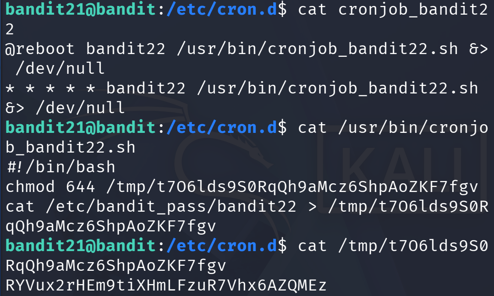

# Write-up

## Đề cho
A program is running automatically at regular intervals from `cron`, the time-based job scheduler. Look in `/etc/cron.d/` for the configuration and see what command is being executed.
## Solve
Ở bài này chúng ta sẽ tìm hiểu file `crontab` là gì.
**Crontab (cron table) là một file cấu hình chứa danh sách các lệnh được lên lịch để chạy tự động tại các thời điểm cụ thể trên hệ thống Unix/Linux.**

File `cronjob_bandit22` cho ta thấy nó tự chạy `/usr/bin/cronjob_bandit22.sh` mỗi phút.

Script đó đọc password từ bandit22 `/etc/bandit_pass/bandit22` và ghi vào `/tmp/t7O6lds9S0RqQh9aMcz6ShpAoZKF7fgv`. Ta chỉ việc đọc file này là ra key cho bandit22

## Key
`RYVux2rHEm9tiXHmLFzuR7Vhx6******`